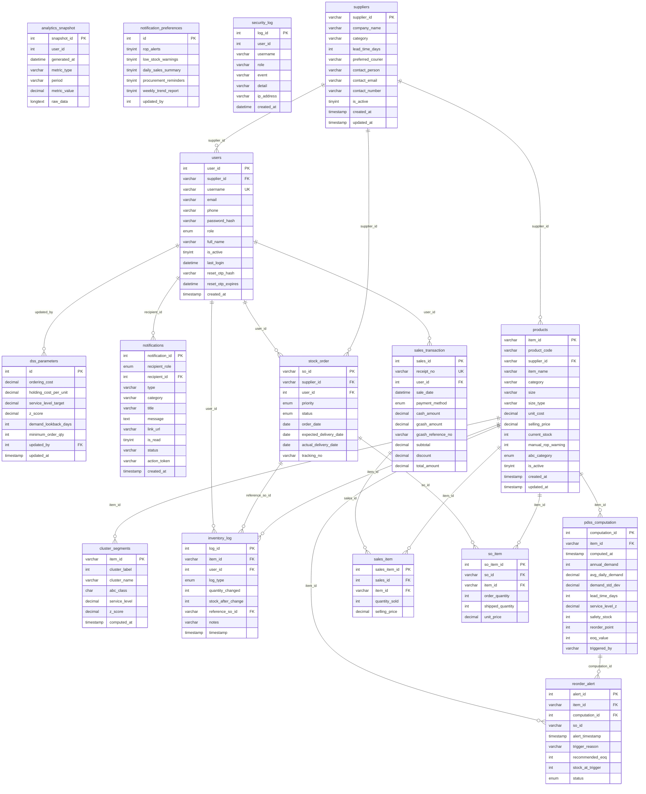

# Database schema - `rfourl_dss`

Generated from the live MariaDB database. `rfourl_dss_schema.sql` (same folder) is the importable SQL (import it in phpMyAdmin, then use Designer).

## ER diagram

## Relationships

| Table | Column | References |
|---|---|---|
| cluster_segments | item_id | products.item_id |
| dss_parameters | updated_by | users.user_id |
| inventory_log | item_id | products.item_id |
| inventory_log | reference_so_id | stock_order.so_id |
| inventory_log | user_id | users.user_id |
| notifications | recipient_id | users.user_id |
| pdss_computation | item_id | products.item_id |
| products | supplier_id | suppliers.supplier_id |
| reorder_alert | computation_id | pdss_computation.computation_id |
| reorder_alert | item_id | products.item_id |
| sales_item | item_id | products.item_id |
| sales_item | sales_id | sales_transaction.sales_id |
| sales_transaction | user_id | users.user_id |
| so_item | item_id | products.item_id |
| so_item | so_id | stock_order.so_id |
| stock_order | supplier_id | suppliers.supplier_id |
| stock_order | user_id | users.user_id |
| users | supplier_id | suppliers.supplier_id |

## Tables

### Sales

#### `sales_transaction`  _(about 1,159 rows)_

One receipt. Imported history uses `receipt_no` = `BIR-YYYYMMDD-NN` (the prefix is how the import is re-run safely or rolled back).

| Column | Type | Null | Key | Notes |
|---|---|---|---|---|
| sales_id | `int(11)` | no | PK | auto_increment |
| receipt_no | `varchar(20)` | no | UNIQUE |  |
| user_id | `int(11)` | yes | index FK -> users.user_id |  |
| sale_date | `datetime` | no |  |  |
| payment_method | `enum('Cash','GCash','Bank Transfer','Credit Card','Split')` | no |  |  |
| cash_amount | `decimal(10,2)` | no |  |  |
| gcash_amount | `decimal(10,2)` | no |  |  |
| gcash_reference_no | `varchar(50)` | yes |  |  |
| subtotal | `decimal(10,2)` | no |  |  |
| discount | `decimal(10,2)` | yes |  |  |
| total_amount | `decimal(10,2)` | no |  |  |

#### `sales_item`  _(about 2,706 rows)_

One line of a receipt. Cascade-deleted with its receipt.

| Column | Type | Null | Key | Notes |
|---|---|---|---|---|
| sales_item_id | `int(11)` | no | PK | auto_increment |
| sales_id | `int(11)` | no | index FK -> sales_transaction.sales_id |  |
| item_id | `varchar(15)` | no | index FK -> products.item_id |  |
| quantity_sold | `int(11)` | no |  |  |
| selling_price | `decimal(10,2)` | no |  |  |

### Catalog & inventory

#### `products`  _(about 687 rows)_

One row per sellable item **and size**. `size` holds the size (`7.5`, `M`, `32`, `XL+35`), `size_type` says what kind it is. `product_code` links a row to the cleaned catalog (`P-0001`...) and is set only on rows created by the history import. Rows created by the import have `is_active = 0`, no supplier and no stock, so the DSS ignores them.

| Column | Type | Null | Key | Notes |
|---|---|---|---|---|
| item_id | `varchar(15)` | no | PK |  |
| product_code | `varchar(10)` | yes | index |  |
| supplier_id | `varchar(10)` | yes | index FK -> suppliers.supplier_id |  |
| item_name | `varchar(100)` | no |  |  |
| category | `varchar(50)` | no |  |  |
| size | `varchar(10)` | yes |  |  |
| size_type | `varchar(10)` | yes |  |  |
| unit_cost | `decimal(10,2)` | no |  |  |
| selling_price | `decimal(10,2)` | no |  |  |
| current_stock | `int(11)` | no |  |  |
| manual_rop_warning | `int(11)` | yes |  |  |
| abc_category | `enum('A','B','C')` | yes |  |  |
| is_active | `tinyint(1)` | yes |  |  |
| created_at | `timestamp` | no |  |  |
| updated_at | `timestamp` | no |  | on update current_timestamp() |

#### `suppliers`  _(about 6 rows)_

| Column | Type | Null | Key | Notes |
|---|---|---|---|---|
| supplier_id | `varchar(10)` | no | PK |  |
| company_name | `varchar(100)` | no |  |  |
| category | `varchar(50)` | yes |  |  |
| lead_time_days | `int(11)` | no |  |  |
| preferred_courier | `varchar(100)` | yes |  |  |
| contact_person | `varchar(100)` | yes |  |  |
| contact_email | `varchar(100)` | yes |  |  |
| contact_number | `varchar(20)` | yes |  |  |
| is_active | `tinyint(1)` | yes |  |  |
| created_at | `timestamp` | no |  |  |
| updated_at | `timestamp` | no |  | on update current_timestamp() |

#### `inventory_log`  _(about 3,148 rows)_

| Column | Type | Null | Key | Notes |
|---|---|---|---|---|
| log_id | `int(11)` | no | PK | auto_increment |
| item_id | `varchar(15)` | no | index FK -> products.item_id |  |
| user_id | `int(11)` | yes | index FK -> users.user_id |  |
| log_type | `enum('MANUAL_ADJUSTMENT','RESTOCK','SALE','RETURN','DAMAGED_LOST')` | no |  |  |
| quantity_changed | `int(11)` | no |  |  |
| stock_after_change | `int(11)` | no |  |  |
| reference_so_id | `varchar(15)` | yes | index FK -> stock_order.so_id |  |
| notes | `varchar(255)` | yes |  |  |
| timestamp | `timestamp` | no |  |  |

### Procurement

#### `stock_order`  _(about 1,330 rows)_

| Column | Type | Null | Key | Notes |
|---|---|---|---|---|
| so_id | `varchar(15)` | no | PK |  |
| supplier_id | `varchar(10)` | no | index FK -> suppliers.supplier_id |  |
| user_id | `int(11)` | yes | index FK -> users.user_id |  |
| priority | `enum('Urgent','Order','Planned')` | yes |  |  |
| status | `enum('Order Confirmed','Preparing','Shipped','Delivered','Cancelled')` | yes |  |  |
| order_date | `date` | no |  |  |
| expected_delivery_date | `date` | yes |  |  |
| actual_delivery_date | `date` | yes |  |  |
| tracking_no | `varchar(30)` | yes |  |  |

#### `so_item`  _(about 1,333 rows)_

| Column | Type | Null | Key | Notes |
|---|---|---|---|---|
| so_item_id | `int(11)` | no | PK | auto_increment |
| so_id | `varchar(15)` | no | index FK -> stock_order.so_id |  |
| item_id | `varchar(15)` | no | index FK -> products.item_id |  |
| order_quantity | `int(11)` | no |  |  |
| shipped_quantity | `int(11)` | yes |  |  |
| unit_price | `decimal(10,2)` | no |  |  |

### Decision support (computed by `php spark dss:run`)

#### `dss_parameters`  _(about 0 rows)_

| Column | Type | Null | Key | Notes |
|---|---|---|---|---|
| id | `int(11)` | no | PK | auto_increment |
| ordering_cost | `decimal(10,2)` | no |  |  |
| holding_cost_per_unit | `decimal(10,2)` | no |  |  |
| service_level_target | `decimal(5,2)` | no |  |  |
| z_score | `decimal(5,3)` | no |  |  |
| demand_lookback_days | `int(11)` | no |  |  |
| minimum_order_qty | `int(11)` | no |  |  |
| updated_by | `int(11)` | yes | index FK -> users.user_id |  |
| updated_at | `timestamp` | no |  | on update current_timestamp() |

#### `pdss_computation`  _(about 2,810 rows)_

EOQ / safety stock / reorder point per item per run (computed, not entered).

| Column | Type | Null | Key | Notes |
|---|---|---|---|---|
| computation_id | `int(11)` | no | PK | auto_increment |
| item_id | `varchar(15)` | no | index FK -> products.item_id |  |
| computed_at | `timestamp` | no |  |  |
| annual_demand | `int(11)` | yes |  |  |
| avg_daily_demand | `decimal(10,2)` | yes |  |  |
| demand_std_dev | `decimal(10,2)` | yes |  |  |
| lead_time_days | `int(11)` | yes |  |  |
| service_level_z | `decimal(5,3)` | yes |  |  |
| safety_stock | `int(11)` | yes |  |  |
| reorder_point | `int(11)` | yes |  |  |
| eoq_value | `int(11)` | yes |  |  |
| triggered_by | `varchar(50)` | yes |  |  |

#### `cluster_segments`  _(about 562 rows)_

K-Means cluster and ABC class per item (computed).

| Column | Type | Null | Key | Notes |
|---|---|---|---|---|
| item_id | `varchar(15)` | no | PK FK -> products.item_id |  |
| cluster_label | `int(11)` | no |  |  |
| cluster_name | `varchar(50)` | yes |  |  |
| abc_class | `char(1)` | yes |  |  |
| service_level | `decimal(5,2)` | yes |  |  |
| z_score | `decimal(5,3)` | yes |  |  |
| computed_at | `timestamp` | no |  | on update current_timestamp() |

#### `reorder_alert`  _(about 14 rows)_

| Column | Type | Null | Key | Notes |
|---|---|---|---|---|
| alert_id | `int(11)` | no | PK | auto_increment |
| item_id | `varchar(15)` | no | index FK -> products.item_id |  |
| computation_id | `int(11)` | yes | index FK -> pdss_computation.computation_id |  |
| so_id | `varchar(20)` | yes |  |  |
| alert_timestamp | `timestamp` | no |  |  |
| trigger_reason | `varchar(100)` | yes |  |  |
| recommended_eoq | `int(11)` | yes |  |  |
| stock_at_trigger | `int(11)` | yes |  |  |
| status | `enum('Active','Acknowledged','Ordered','Fulfilled','Dismissed')` | no |  |  |

#### `analytics_snapshot`  _(about 8 rows)_

| Column | Type | Null | Key | Notes |
|---|---|---|---|---|
| snapshot_id | `int(11) unsigned` | no | PK | auto_increment |
| user_id | `int(11)` | no | index |  |
| generated_at | `datetime` | no |  |  |
| metric_type | `varchar(50)` | no | index |  |
| period | `varchar(20)` | no |  |  |
| metric_value | `decimal(15,4)` | no |  |  |
| raw_data | `longtext` | yes |  |  |

### Users & system

#### `users`  _(about 10 rows)_

| Column | Type | Null | Key | Notes |
|---|---|---|---|---|
| user_id | `int(11)` | no | PK | auto_increment |
| supplier_id | `varchar(10)` | yes | index FK -> suppliers.supplier_id |  |
| username | `varchar(50)` | no | UNIQUE |  |
| email | `varchar(100)` | yes |  |  |
| phone | `varchar(20)` | yes |  |  |
| password_hash | `varchar(255)` | no |  |  |
| role | `enum('Admin','Staff','Supplier')` | no |  |  |
| full_name | `varchar(100)` | no |  |  |
| is_active | `tinyint(1)` | yes |  |  |
| last_login | `datetime` | yes |  |  |
| reset_otp_hash | `varchar(255)` | yes |  |  |
| reset_otp_expires | `datetime` | yes |  |  |
| created_at | `timestamp` | no |  |  |

#### `notifications`  _(about 30 rows)_

| Column | Type | Null | Key | Notes |
|---|---|---|---|---|
| notification_id | `int(11)` | no | PK | auto_increment |
| recipient_role | `enum('Admin','Staff','Supplier')` | no |  |  |
| recipient_id | `int(11)` | yes | index FK -> users.user_id |  |
| type | `varchar(50)` | no |  |  |
| category | `varchar(20)` | yes |  |  |
| title | `varchar(150)` | no |  |  |
| message | `text` | yes |  |  |
| link_url | `varchar(255)` | yes |  |  |
| is_read | `tinyint(1)` | yes |  |  |
| status | `varchar(20)` | yes |  |  |
| action_token | `varchar(64)` | yes |  |  |
| created_at | `timestamp` | no |  |  |

#### `notification_preferences`  _(about 0 rows)_

| Column | Type | Null | Key | Notes |
|---|---|---|---|---|
| id | `int(11) unsigned` | no | PK | auto_increment |
| rop_alerts | `tinyint(1)` | no |  |  |
| low_stock_warnings | `tinyint(1)` | no |  |  |
| daily_sales_summary | `tinyint(1)` | no |  |  |
| procurement_reminders | `tinyint(1)` | no |  |  |
| weekly_trend_report | `tinyint(1)` | no |  |  |
| updated_by | `int(11)` | yes |  |  |

#### `security_log`  _(about 4 rows)_

Audit trail: logins, password/email changes, archive and purge actions.

| Column | Type | Null | Key | Notes |
|---|---|---|---|---|
| log_id | `int(11) unsigned` | no | PK | auto_increment |
| user_id | `int(11)` | yes |  |  |
| username | `varchar(100)` | yes |  |  |
| role | `varchar(20)` | yes |  |  |
| event | `varchar(50)` | no | index |  |
| detail | `varchar(255)` | yes |  |  |
| ip_address | `varchar(45)` | yes |  |  |
| created_at | `datetime` | yes | index |  |

## What changed for the history import

- `products.product_code` (`VARCHAR(10)`, nullable) - catalog id, only on products the import created.
- `products.size_type` (`VARCHAR(10)`, nullable) - `SHOE`, `LETTER`, `WAIST`, `CAP` or `SET`.
- index `idx_products_code_size (product_code, size)`.
- `security_log` table (audit trail) - added by migration `2026-10-09-100000`.
- No new tables for sales: imported history is ordinary `sales_transaction` + `sales_item` rows.

## Notes for the ERD

- A **product** is one item *and size*: a Combat Shoes size 8 and a size 9 are two products. Sizes live in `products.size`; there is no separate size table.
- Sales do not store the size themselves; they point at the product row that carries it.
- `pdss_computation`, `cluster_segments`, `reorder_alert` and `analytics_snapshot` are outputs of the DSS run. They reference `products` but nothing references them except `reorder_alert -> pdss_computation`.
- `analytics_snapshot`, `notification_preferences` and `dss_parameters` (except `updated_by`) have no foreign keys; draw them as stand-alone tables.
- `migrations` is framework bookkeeping and is left out of the diagram.
